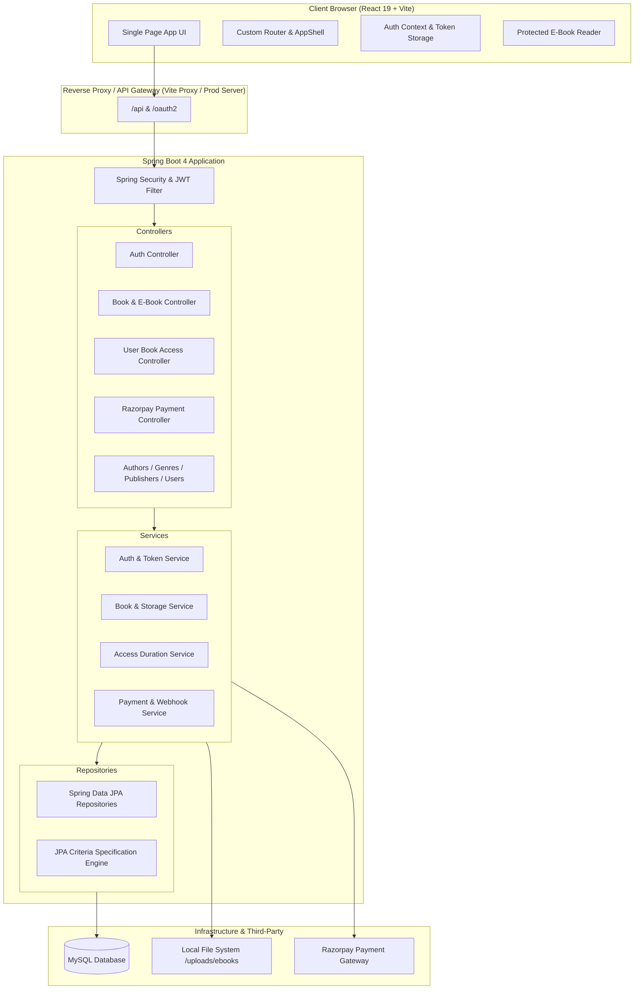

# E-Library & Digital Book Management System

[](https://www.oracle.com/java/)
[](https://spring.io/projects/spring-boot)
[](https://react.dev/)
[](https://vitejs.dev/)
[](https://spring.io/projects/spring-security)
[](https://www.mysql.com/)
[](https://razorpay.com/)

A full-stack, enterprise-grade Digital Library Management and E-Reading platform. Built with a high-performance **Spring Boot** REST backend and a modern **React (Vite)** single-page application. Features secure JWT stateless authentication, role-based access control (RBAC), multi-criteria book searching, PDF e-book rendering with access-control protection, and integrated online payments via **Razorpay** for premium access leases.

---

## Table of Contents

- [Key Architecture & Features](#key-architecture--features)
  - [Backend Highlights](#backend-highlights)
  - [Frontend Highlights](#frontend-highlights)
- [System Architecture](#system-architecture)
- [Tech Stack](#tech-stack)
- [Project Directory Structure](#project-directory-structure)
- [API Reference](#api-reference)
  - [Authentication (`/api/v1/auth`)](#authentication-apiv1auth)
  - [Books & E-Books (`/api/books`)](#books--e-books-apibooks)
  - [User Access & Library (`/api/book-access`)](#user-access--library-apibook-access)
  - [Payments & Webhooks (`/api/payments`)](#payments--webhooks-apipayments)
  - [Master Data (Authors, Genres, Publishers)](#master-data-authors-genres-publishers)
  - [User Management (`/api/v1/users`)](#user-management-apiv1users)
- [Environment Variables & Setup](#environment-variables--setup)
- [Getting Started](#getting-started)
  - [Prerequisites](#prerequisites)
  - [Backend Setup](#backend-setup)
  - [Frontend Setup](#frontend-setup)
- [Security & Access Control](#security--access-control)
- [License & Contribution](#license--contribution)

---

## Key Architecture & Features

### Backend Highlights
- **Stateless JWT Security Architecture**: Access tokens with short TTL and refresh tokens stored and rotatable in database; automated expired token cleanup scheduler.
- **Role-Based Access Control (RBAC)**: Fine-grained method-level security with `@PreAuthorize` across roles (`ADMIN`, `LIBRARIAN`, `MEMBER`).
- **Universal Criteria Search**: Dynamic JPA Specification queries supporting free-text search across titles, ISBNs, author names, and genres, along with access type filters and price range constraints.
- **Digital Access & Leases**: Time-limited book access duration handling (`FREE` vs `PAID`) with automated expiration checks.
- **E-Book Streaming & Cover Protection**: Protected binary streaming of PDF content via secure token checks, preventing unauthorized downloads.
- **Payment Lifecycle & Webhook Reconciliation**: Integrated Razorpay order creation, client signature verification (`HmacSHA256`), failure handling, and asynchronous webhook reconciliation.

### Frontend Highlights
- **Industry-Standard Design**: Polished, professional UI built with semantic HTML, custom CSS variables, and zero dependency on AI-generated placeholder emoji artifacts (100% SVG iconography).
- **Responsive Navigation**: Topbar with role-masked avatar profile (hiding internal IDs and sensitive information from standard members).
- **Interactive E-Book Reader**: Integrated reader page with protected content banners, PDF blob streaming, and responsive viewport sizing.
- **Catalog Filtering & Sorting**: Instant universal keyword search, quick access pills (`All`, `Free`, `Premium`), and real-time backend-driven sorting (`Newest`, `Price Low/High`, `Title A-Z`).
- **Comprehensive Administration**: Admin dashboards and dedicated management consoles for books, authors, genres, publishers, and system users.

---

## System Architecture



---

## Tech Stack

| Domain | Technology | Description |
|---|---|---|
| **Backend Framework** | Java 21, Spring Boot 4.1.0 | RESTful API micro-modular application |
| **Persistence & ORM** | Spring Data JPA, Hibernate, MySQL 8 | Relational schema, indices, dynamic specifications |
| **Security & Auth** | Spring Security 6, JJWT (0.12.6) | Stateless JWT bearer authentication, BCrypt |
| **Payment Gateway** | Razorpay Java SDK 1.4.10 | Order creation, signature verification, webhooks |
| **Build & Tooling** | Maven (Wrapper included) | Dependency lifecycle and artifact build |
| **Frontend Framework**| React 19.2.8 | Functional components, Hooks, Context API |
| **Frontend Bundler**  | Vite 8.3.0 | Hot module replacement, lightning production builds |
| **Styling & Assets**  | Custom Design System (CSS3) | Fluid typography, glassmorphism, responsive grid |
| **Code Quality**      | Oxlint | Fast JavaScript/JSX static analysis |

---

## Project Directory Structure

```text
Library Management System/
├── frontend/                               # React Frontend Application
│   ├── public/                             # Static public assets
│   ├── src/
│   │   ├── api/                            # Centralized HTTP & REST clients
│   │   │   ├── accessApi.js
│   │   │   ├── authApi.js
│   │   │   ├── booksApi.js
│   │   │   ├── http.js                     # Fetch wrapper with auto-auth headers
│   │   │   └── paymentsApi.js
│   │   ├── app/                            # Application bootstrap & routing
│   │   │   ├── App.jsx
│   │   │   └── router.js                   # Client-side router & path matcher
│   │   ├── auth/                           # JWT auth provider, token storage
│   │   ├── components/
│   │   │   ├── books/                      # BookCard, CoverImage components
│   │   │   ├── common/                     # Reusable UI (Icons, Modal, Pagination, Alert)
│   │   │   └── layout/                     # AppShell, Topbar, Role Badges
│   │   ├── pages/                          # Application views
│   │   │   ├── AdminDashboardPage.jsx
│   │   │   ├── BookDetailPage.jsx
│   │   │   ├── CatalogPage.jsx
│   │   │   ├── LoginPage.jsx
│   │   │   ├── ManageBooksPage.jsx
│   │   │   ├── MyLibraryPage.jsx
│   │   │   └── ReaderPage.jsx
│   │   ├── App.css                         # Core application styling
│   │   └── index.css                       # Design variables, typography, animations
│   ├── package.json
│   └── vite.config.js
├── src/main/java/com/sagar/                 # Spring Boot Backend Codebase
│   ├── access/                             # Book access duration, grants & library
│   ├── auth/                               # Registration, login, refresh token scheduler
│   ├── author/                             # Author records & lifecycle management
│   ├── book/                               # Book entity, search specification, file uploads
│   ├── exception/                          # Global exception handling & API error responses
│   ├── genre/                              # Genre & category hierarchies
│   ├── payment/                            # Razorpay orders, verifications & webhooks
│   ├── publisher/                          # Publisher records management
│   ├── security/                           # JWT filters, entry points, BCrypt config
│   └── user/                               # User entity, roles, account management
├── src/main/resources/
│   └── application.properties              # Environment configuration & DB bindings
├── uploads/                                # Storage directory for covers and PDF files
├── pom.xml                                 # Maven dependencies and build definition
└── README.md
```

---

## API Reference

### Authentication (`/api/v1/auth`)
| Method | Endpoint | Access | Description |
|---|---|---|---|
| `POST` | `/api/v1/auth/register` | Public | Register a new member account |
| `POST` | `/api/v1/auth/login` | Public | Authenticate user and obtain access/refresh tokens |
| `POST` | `/api/v1/auth/refresh` | Public | Exchange refresh token for fresh access token |
| `POST` | `/api/v1/auth/logout` | Authenticated | Revoke refresh token and invalidate session |

### Books & E-Books (`/api/books`)
| Method | Endpoint | Access | Description |
|---|---|---|---|
| `GET` | `/api/books` | Authenticated | Paginated list of all books |
| `GET` | `/api/books/active` | Authenticated | Retrieve all currently active books |
| `GET` | `/api/books/{id}` | Authenticated | Get book details and current user access status |
| `GET` | `/api/books/isbn/{isbn}`| Authenticated | Lookup a book by ISBN |
| `POST` | `/api/books/search` | Authenticated | Dynamic criteria search (keyword, filters, sort) |
| `POST` | `/api/books` | Admin / Librarian | Create new book entry |
| `PUT` | `/api/books/{id}` | Admin / Librarian | Update existing book metadata |
| `DELETE`| `/api/books/{id}` | Admin Only | Remove book from catalog |
| `PATCH` | `/api/books/{id}/activate` | Admin / Librarian | Activate a book |
| `PATCH` | `/api/books/{id}/deactivate` | Admin / Librarian | Deactivate a book |
| `POST` | `/api/books/{id}/ebook`| Admin Only | Upload PDF e-book file (`multipart/form-data`) |
| `GET` | `/api/books/{id}/read` | Authenticated | Stream secured PDF e-book binary |
| `POST` | `/api/books/{id}/cover`| Admin / Librarian | Upload book cover image |
| `GET` | `/api/books/{id}/cover`| Authenticated | Fetch book cover image binary |

### User Access & Library (`/api/book-access`)
| Method | Endpoint | Access | Description |
|---|---|---|---|
| `GET` | `/api/book-access/my-library` | Authenticated | List all active book leases for current user |
| `GET` | `/api/book-access/my-books` | Authenticated | List access history for current user |
| `GET` | `/api/book-access/books/{id}` | Authenticated | Check specific access validity for a book |
| `POST` | `/api/book-access/books/{id}/free-access` | Authenticated | Grant free lease for eligible books |

### Payments & Webhooks (`/api/payments`)
| Method | Endpoint | Access | Description |
|---|---|---|---|
| `POST` | `/api/payments/create` | Authenticated | Create Razorpay order for book access |
| `POST` | `/api/payments/verify` | Authenticated | Verify HMAC signature and activate book access |
| `POST` | `/api/payments/failed` | Authenticated | Record payment failure event |
| `POST` | `/api/payments/webhook`| Razorpay Server | Automated webhook reconciliation handler |

### Master Data (Authors, Genres, Publishers)
| Resource | Base Endpoint | Features |
|---|---|---|
| **Authors** | `/api/authors` | CRUD, activation/deactivation, listing active authors |
| **Genres** | `/api/genres` | Hierarchical genres, subgenres, display order management |
| **Publishers** | `/api/publishers` | Publishing houses records, activation controls |

### User Management (`/api/v1/users`)
| Method | Endpoint | Access | Description |
|---|---|---|---|
| `GET` | `/api/v1/users` | Admin Only | Paginated list of all system users |
| `GET` | `/api/v1/users/{id}` | Admin / Self | Retrieve user profile details |
| `POST` | `/api/v1/users` | Admin Only | Create user account with assigned role |
| `PUT` | `/api/v1/users/{id}` | Admin Only | Update user profile and role assignment |
| `DELETE`| `/api/v1/users/{id}` | Admin Only | Delete user account |

---

## Environment Variables & Setup

Create a `.env` file in the project root (or set OS environment variables):

```env
# Database Settings
DB_URL=jdbc:mysql://localhost:3306/lbms?createDatabaseIfNotExist=true&useSSL=false
DB_USERNAME=root
DB_PASSWORD=your_secure_password

# Razorpay Credentials (Test or Production)
RAZORPAY_KEY_ID=rzp_test_YourKeyIdHere
RAZORPAY_KEY_SECRET=YourRazorpayKeySecretHere
RAZORPAY_WEBHOOK_SECRET=YourWebhookSecretHere
```

---

## Getting Started

### Prerequisites
- **JDK 21** installed and configured in `PATH`
- **Node.js 18+** & **npm** installed
- **MySQL 8.0+** running locally or in a container

### Backend Setup

1. **Clone the repository**:
   ```bash
   git clone https://github.com/your-username/library-management-system.git
   cd "Library Management System"
   ```

2. **Configure environment**:
   Copy `.env.example` to `.env` and provide your MySQL and Razorpay credentials.

3. **Compile and run the Spring Boot application**:
   - On Windows:
     ```cmd
     .\mvnw.cmd spring-boot:run
     ```
   - On Linux/macOS:
     ```bash
     ./mvnw spring-boot:run
     ```
   The backend will start on `http://localhost:8080`.

### Frontend Setup

1. **Navigate to the frontend directory**:
   ```bash
   cd frontend
   ```

2. **Install dependencies**:
   ```bash
   npm install
   ```

3. **Run the Vite development server**:
   ```bash
   npm run dev
   ```
   The application will be accessible at `http://localhost:5173` (proxied to port 8080).

4. **Production Build**:
   ```bash
   npm run build
   ```

---

## Security & Access Control

- **Stateless Tokens**: The backend issues cryptographically signed JWT tokens containing claims for `userId`, `sub` (email), and `role`.
- **Method Security**: All controller methods enforce strict security guards (`@PreAuthorize("hasRole('ADMIN')")`, `@PreAuthorize("isAuthenticated()")`).
- **Data Protection & Sanitization**:
  - Direct database user emails and internal system identifiers are masked on standard user views.
  - Member interfaces reveal only permissible actions; administrative control interfaces are restricted to authenticated admins and librarians.
- **Protected PDF Viewing**: PDF e-book binaries are never exposed via public static URLs. They are streamed strictly through authenticated blob endpoints verifying active, unexpired lease records.

---

## License & Contribution

This project is licensed under the MIT License. Contributions, issues, and feature requests are welcome. Feel free to submit a pull request!
